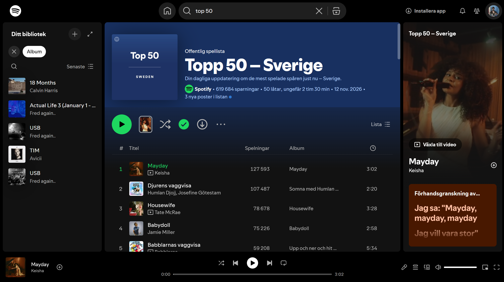
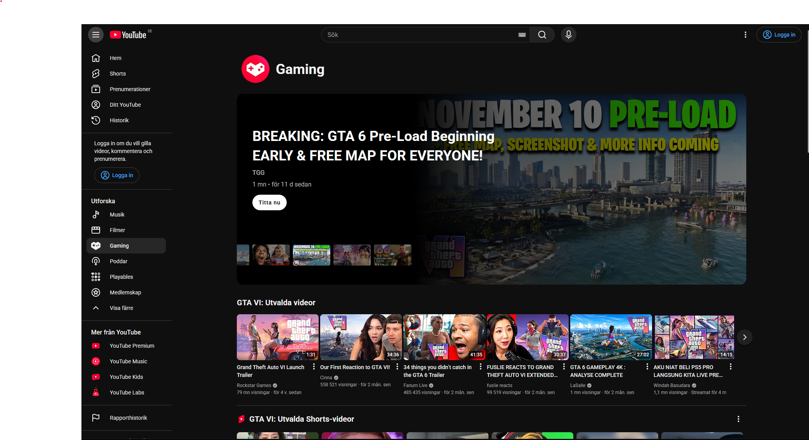
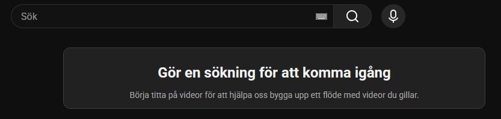
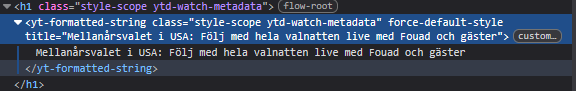
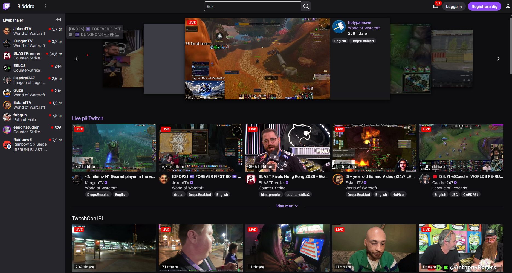

Utvärdera webbplatsers färgval och känslan de signalerar
========================================================

Uppgiften handlar om att välja ut ett antal olika hemsidor och dokumentera deras färgpalett och typografi. I samma uppgift ska man också argumentera kring valet av färg kontra den känsla jag tror hemsidan eventuellt vill signalera med sitt färgval.

## Urval
--------------------------
Här finns de tre olika hemsidor jag har valt att undersöka. Jag valde dessa sidor eftersom de hemsidorna använder jag mest och känner igen de.

1. Spotify (#1ED760)

2. YouTube (#FF0033)

3. Twitch (#9147FF)

## Metod
--------------------------
För att analysera hemsidornas färgval använde jag först DevTools på Firefox för att inspektera CSS:en.

Sedan använde jag "Eyedropper" på Firefox för att hämta ut HEX-värdet på huvudfärgen.

Resultat
--------------------------

### Färgpaletten och typografi
#### Spotify

Spotify använder 3 olika färger som deras färgpalett.
<table style="border-spacing: 4px; border-collapse: separate">
<tr>
<td style="height: 50px; width: 50px; background-color: #000">
#000000
<td style="height: 50px; width: 50px; background-color: #121212">
#121212
<td style="height: 50px; width: 50px; background-color: #1ED760">
#1ED760
</tr>
</table>

Spotify använder ett mörkt färgschema där svart(#000000), och mörkgrått (#121212) används mest på gränsnitten. Trots alla känner igen Spotifys profilfärg (#1ED760), det används mindre i gränsnitten.

Färgsättningen kan beskrivas som ett akromatiskt färgschema, där gränsnitten används mest svart som bakgrund med nyanser av grått.

Spotify använder sitt eget typsnitt som heter [Spotify Mix](https://newsroom.spotify.com/2024-05-22/introducing-spotify-mix-our-new-and-exclusive-font/) som är baserat på Sans-Serif. I Spotifys inlägg angående deras typsnitt har de skapat typsnittet specfikt för deras visuella identitiet.

När det gäller H1-H3 samt brödtext, genom att använda DevTools igen, jag märkte att de använder faktiskt inte H1-H3 men istället Spotify kör `` klassen på allt text, dock kör de olika klasser beroende på vilken storlek text det ska vara.

Jag tycker att Spotifys färgval och typografi passar in i deras visuella profil, eftersom med det mörka färgschema med deras custom-typsnitt skapar ett rent gränsnitt med musik i focus.

----
#### YouTube

YouTube använder 3 olika färger som deras färgpalett.

<table style="border-spacing: 4px; border-collapse: separate">
<tr>
<td style="height: 50px; width: 50px; background-color: #FF0033">
#FF0033
<td style="height: 50px; width: 50px; background-color: #0f0f0f">
#0f0f0f
<td style="height: 50px; width: 50px; background-color: #ffffff">
#ffffff
</tr>
</table>

YouTube har ett rött(#FF0033) profil färg där den kombineras antingen med vitt eller grått beroende på användarens val av ljus eller mörkt tema.

Färgschemat är huvudsakligen akromatiskt med rött som en accentfärg. Där de vitt eller grått färgerna dominerar gränsnitten och de använder den röda färgen mest i deras logotyp eller vissa interaktiva element, tex knappar. Dock under tiden har de testat att byta färger också, tex att deras "Subscribe" knapp gick från rött till vitt också.

YouTube använder olika nyanser av mörkt/grått färg för att skapa en tydligt kontrast mot olika elementer. Till exempel, sök-knappen har en ljusare grå bakgrund än andra element i området, för att visa lättare för användaren att identifera den som en knapp.

När det gäller typsnittet, precis som Spotify, YouTube kör också ett custom-typsnitt som heter [YouTube Sans](https://design.google/library/youtube-sans-font).

YouTube kör dock faktiskt H1-H3 istället för `` som Spotify kör. Dock "wrapar" de texten i ett eget klass som heter `<yt-formatted-string>` när det kommer till texten, själv har jag inte undersökt hur det påverkar texten men jag antar att det är bara ett klass för att ge olika egenskaper till texten.

Jag tycker att YouTubes färgval och typografi passar också in i deras visuella profil precis som Spotify, dock eftersom de har förändrat gränssnitt designen flera gånger under åren så är det svårt att koppas deras identitet till en specifik design. Trotts dessa förändringar är YouTube fortfarade lätt att känna igen.

----
#### Twitch

Twitch använder 3 olika färger som deras färgpalett.

<table style="border-spacing: 4px; border-collapse: separate">
<tr>
<td style="height: 50px; width: 50px; background-color: #9147FF">
#9147FF
<td style="height: 50px; width: 50px; background-color: #0e0e10">
#0e0e10
<td style="height: 50px; width: 50px; background-color: #f7f7f8">
#f7f7f8
</tr>
</table>

Twitch har ett lila(#9147FF) profil färg, Twitch kombinerar profilfärgen med naturella färger som vitt, grått och svart beroende på användarens val av temat.

Precis som YouTube, Twitch använder ett huvudsakligen akromatiskt färgschema med lila som accentfärg. Skillnaden är att Twitch använder faktiskt mer av sin lila färg i gränssnittet.

Jag tycker att det visar att Twitch försöker mer att använda deras profilfärg för att sticka och att skapa en tydligare visuell identitet. Till exempel, deras "Registrera dig" bar syns tydligt i lila för att ge användaren uppmärksamhet. Eller att deras "Verified" badge är också lila.

När det kommer till typografi, så har de faktiskt inte en custom-typsnitt som Spotify eller YouTube har. 

I DevTools hittade jag att de kör två olika variabler när det gäller typsnitt: `--font-base` och `--font-display`. Den första prioriterar typsnittet Inter, som används mest för vanliga texter, medans den andrar variabeln prioriterar Roobert, som används mest för a-taggar eller rubriker.

Båda typsnitt är en del av Sans-Serif familjen, vilket ger webbplatsen ett modernt utseende, Twitch också har definerat alternativa typsnitt som webbläsaren kan använda.

----
## Analys

Efter jag har undersökt alla tre webplatsernas färgval och typografi, jag har märkt att alla tre hemsidor använder en akromatiskt färgschema med en tydlig profilfärg. Spotify använder grönt, YouTube rött och Twitch lila, sedan använder de en mer neutrala färg som vitt, grått eller svart i gränssnitten.

En anledning till detta kan vara att webbplatserna behöver kunna fungera i båda ljus och mörkt läge. Genom att använda neutrala bakgrundsfärger kan de behålla samma profilfärg utan att komprimissa deras märke oavsett vilket tema användaren väljer.

När det gäller typografi, jag har också märkt att hemsidor tar typografi på allvar, som nämnde i Spotifys inlägg angående deras custom-typsnitt, de valde att samarbeta med ett företag och tillverka ett typsnitt som är just unik till deras märke/identitet men också kan kopplas till musik.

Jag tror att detta visar hur typografi och färg handlar inte bara om läsbarhet längre men också att kunna skapa ett identitet som man kan känna igen. Om en person nämner en musikstreamingtjänst som är grön, många tänker direkt på Spotify. På samma sätt förknippas en blå profilfärg inom sociala medier ofta med Facebook. Detta visar hur starkt en färg kan kopplas till ett varumärke och varför är det viktigt för webbplatser att ha en tydligt visuel identitet.

## Referens
[Spotify Mix font announcement](https://newsroom.spotify.com/2024-05-22/introducing-spotify-mix-our-new-and-exclusive-font/)

[YouTube Sans: The Making of a Typeface](https://design.google/library/youtube-sans-font)

*Jonathan Friberg*
